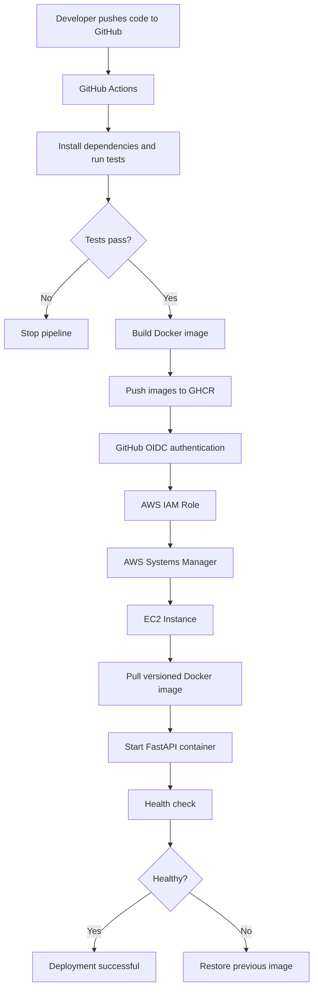

# ML API CI/CD Pipeline with AWS, Docker and GitHub Actions

An end-to-end Machine Learning API deployment project demonstrating automated testing, Docker containerization, continuous integration, continuous deployment, AWS infrastructure, health checks, and rollback mechanisms.

## Project Overview

This project deploys an Iris flower classification model through a FastAPI application. It uses a Random Forest classifier to predict flower species based on four input measurements.

The deployment pipeline is automated using GitHub Actions, Docker, GitHub Container Registry (GHCR), AWS EC2, and AWS Systems Manager (SSM).

The pipeline automatically tests application code, builds and publishes versioned Docker images, authenticates with AWS using OpenID Connect (OIDC), and deploys the application to EC2.

Deployment health checks help identify failed deployments, while a Bash rollback handler attempts to restore the previously running image.

## Architecture



## Technology Stack

| Category | Technologies |
|---|---|
| Programming | Python |
| ML Framework | Scikit-learn |
| API | FastAPI, Uvicorn |
| Testing | Pytest |
| Containerization | Docker |
| CI/CD | GitHub Actions |
| Container Registry | GitHub Container Registry |
| Cloud | AWS EC2 |
| Deployment | AWS Systems Manager |
| Authentication | AWS IAM, GitHub OIDC |
| Version Control | Git, GitHub |

## Project Structure

```text
ml-cicd-project/
│
├── app/
│   ├── __init__.py
│   ├── main.py
│   └── model.py
│
├── tests/
│   └── test_api.py
│
├── .github/
│   └── workflows/
│       └── ci.yml
│
├── train.py
├── model.joblib
├── requirements.txt
├── Dockerfile
├── .dockerignore
├── .gitignore
└── README.md
```

## Machine Learning Model

The application uses the Iris dataset from Scikit-learn.

- Algorithm: Random Forest Classifier
- Number of estimators: 100
- Random state: 42
- Input features: Four numerical flower measurements
- Output: Predicted Iris species and prediction confidence

The trained model is serialized using Joblib and loaded by the FastAPI application.

## API Endpoints

| Method | Endpoint | Description |
|---|---|---|
| GET | `/` | Application status |
| GET | `/health` | Health check |
| POST | `/predict` | Predict Iris flower species |
| GET | `/docs` | Interactive Swagger API documentation |

### Prediction Example

Request:

```json
{
  "sepal_length": 5.1,
  "sepal_width": 3.5,
  "petal_length": 1.4,
  "petal_width": 0.2
}
```

Example response:

```json
{
  "prediction": "setosa",
  "confidence": 1.0
}
```

The confidence value is illustrative; actual predictions depend on the trained model.

## CI/CD Pipeline

The GitHub Actions workflow is defined in:

`.github/workflows/ci.yml`

The pipeline consists of three jobs.

### 1. Continuous Integration

Triggered by pushes and pull requests to the `main` branch.

- Checks out the repository.
- Sets up Python 3.12.
- Installs project dependencies.
- Trains the ML model in the test job.
- Executes automated tests using Pytest.

The pipeline stops if the tests fail.

### 2. Docker Build and Push

Runs after successful tests on pushes to `main`.

- Builds the Docker image.
- Publishes the image to GitHub Container Registry.
- Creates two image tags:
  - `latest`
  - Git commit SHA

Example:

```text
ghcr.io/snch0718/ml-cicd-project:latest
ghcr.io/snch0718/ml-cicd-project:<commit-sha>
```

Commit-specific tags allow deployments to reference an exact application version.

### 3. Automated AWS Deployment

Runs after the Docker image is successfully published.

- GitHub Actions authenticates with AWS using OIDC.
- AWS IAM grants the GitHub Actions role permission to invoke SSM commands.
- SSM executes deployment commands on the EC2 instance.
- EC2 pulls the new Docker image.
- The previous application container is replaced.
- The new application is checked through its `/health` endpoint.

No long-lived AWS access keys are stored in GitHub repository secrets.

## AWS Infrastructure

The deployment uses the following AWS components:

| AWS Service | Purpose |
|---|---|
| EC2 | Hosts the FastAPI Docker container |
| IAM | Controls access to AWS resources |
| IAM OIDC Provider | Establishes trust with GitHub Actions |
| Systems Manager | Executes deployment commands remotely |

The EC2 instance runs Amazon Linux 2023 and Docker.

The application is exposed on port `8000`.

## Deployment Verification and Rollback

After starting the new container, the deployment script checks:

```bash
curl -fsS http://localhost:8000/health
```

The health check is retried for up to 30 seconds.

If the application fails its health check:

1. The rollback handler detects the failure.
2. The failed container is removed.
3. The previously deployed Docker image is restarted.
4. The deployment job reports failure.

The rollback handler was also tested separately using an isolated container on port `8001`, without interrupting the production application.

## Running Locally

### Prerequisites

- Python 3.12
- Git
- Docker Desktop (optional for containerized execution)

### 1. Clone the repository

```bash
git clone https://github.com/Snch0718/ml-cicd-project.git
cd ml-cicd-project
```

### 2. Install dependencies

```bash
python -m pip install -r requirements.txt
```

### 3. Train the model

```bash
python train.py
```

### 4. Run the application

```bash
uvicorn app.main:app --reload
```

Open:

```text
http://localhost:8000/docs
```

### 5. Run tests

```bash
python -m pytest -v
```

## Running with Docker

### Build the image

```bash
docker build -t iris-ml-api:v1 .
```

### Run the container

```bash
docker run -d \
  --name iris-api \
  -p 8000:8000 \
  iris-ml-api:v1
```

### Verify the application

```bash
curl http://localhost:8000/health
```

## Key Engineering Concepts Demonstrated

- Continuous Integration and Continuous Deployment
- Automated unit and API testing
- Docker image creation and versioning
- GitHub Actions workflow orchestration
- AWS IAM roles and least-privilege permissions
- GitHub OIDC authentication
- AWS Systems Manager remote execution
- EC2 application deployment
- Application health checks
- Failure handling and rollback automation

## Future Improvements

- Add deployment notifications.
- Introduce automated container cleanup.
- Add centralized application logging and monitoring.
- Implement blue-green or rolling deployments.
- Add deployment metrics and monitoring dashboards.
- Test automated rollback through a complete GitHub Actions deployment failure.

## Author

**Siddhardh Chochipatla**

GitHub: [Snch0718](https://github.com/Snch0718)